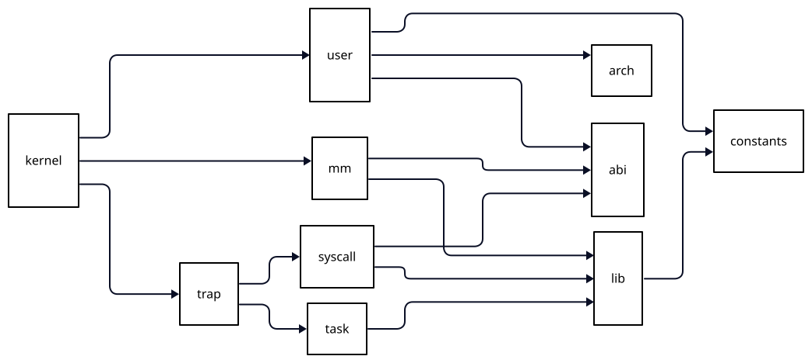

# Docs

## Building System

Generated from [dag.d2](dag.d2) with [D2](https://github.com/d2lang/d2).

## riscv-card

This project includes the [RISC-V Reference Card](https://github.com/jameslzhu/riscv-card)
by [James Zhu](https://github.com/jameslzhu), licensed under the [CC-BY-4.0](LICENSE).

The PDF is included unmodified. No changes have been made to the original work.

> Thanks to this project, I’ve been able to build it much more easily.
